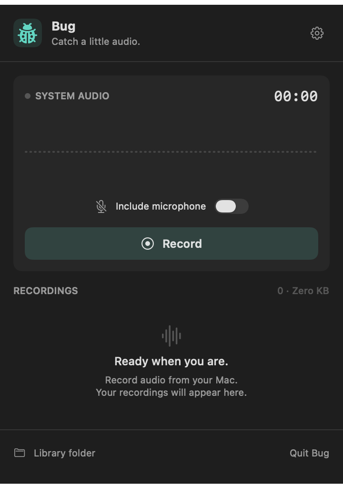
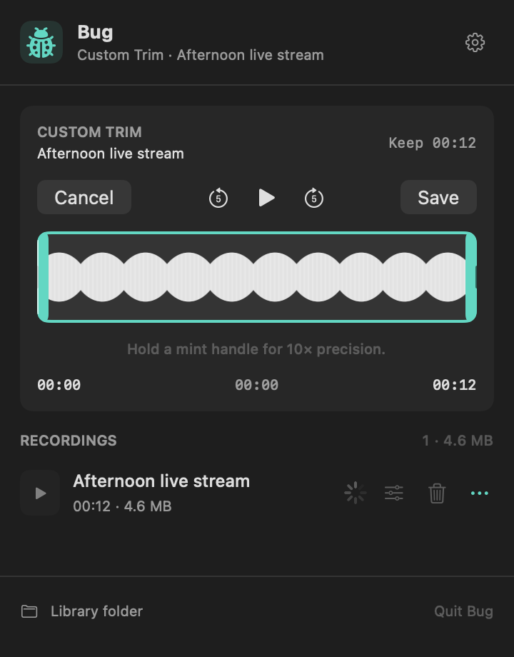

# Bug

Bug is a native macOS menu bar app for recording your computer’s audio signal, with an optional microphone.

Capture samples, internet radio, music, browser audio, livestreams, calls, or whatever else is playing on your Mac. Click **Record**, let it run, then save, trim, and export the audio as WAV or MP3.

It can also keep a separate recording when another app’s recorder lets you down. Start Bug alongside Zoom, Google Meet, FaceTime, or another app, and the audio Bug has captured stays independent of that app’s recording or save process.

This is a personal tool I’m sharing as it stands. If it’s useful, take it. If you want something different, fork it and have your agents, or yourself, make it work the way you want. There’s no promise of ongoing support or a release schedule. You don’t need to wait on me to change your copy.

<p>
  
  
</p>

Recorder and Custom Trim, rendered from the current app interface. The trim preview uses synthetic audio; no live recording or personal library is shown. [Image details](docs/images/README.md).

## What it does today

- Records system audio and an optional microphone after an explicit **Record** click.
- Shows a live waveform and elapsed time, and keeps recording with the panel closed.
- Keeps lossless source recordings in a local library with playback, rename, and recoverable Move to Trash.
- Exports 48 kHz / 24-bit stereo WAV or 320 kbps stereo MP3.
- Offers automatic silence trimming and manual Custom Trim with precision handles. Edits are reversible; playback and both exports use the same saved bounds.
- Reminds you about silence. **Keep Recording** continues, **Stop Recording** saves, and ignoring the reminder leaves recording running.
- Offers launch at login in a compact 360-point panel with a mint accent and no Dock icon.

The app has no accounts, uploads, telemetry, web runtime, or background service. It saves audio locally and does not save screen video. The build process downloads the pinned LAME encoder source once; the app does not need a network connection to record or export.

## Build it yourself

Current source version: **0.6.1**. Source is publicly available; no downloadable binary release is published.

Requires **macOS 15 or newer**, Xcode Command Line Tools with a macOS 15+ SDK, and Swift Testing. Previous implementation validation used Swift 6.3.3 on Apple Silicon with Swift 5 language mode and a Swift 5.9 package manifest. Intel, a universal app, and a separate macOS 15 host have not been verified.

```sh
git clone https://github.com/jimmytheghost/bug.git
cd bug
swift build
./scripts/prepare-encoder.sh
./scripts/test.sh
./scripts/package-app.sh "$PWD/.build/local-package"
# Stop recording and quit any existing Bug before installing.
python3 scripts/install-app.py .build/local-package/Bug.app
open "$HOME/Applications/Bug.app"
```

The encoder build verifies the LAME 3.100 source SHA-256 and builds locally. Nothing is installed globally. Packaging builds for the host architecture. Use the packaged app for recording; `swift run Bug` is only suitable for interface development because permissions and the encoder rely on the app bundle.

All updates go through `scripts/install-app.py` to `~/Applications/Bug.app`. The installer refuses to replace a running Bug and resets only Bug’s ScreenCapture grant when its code identity changes. Default builds use ad-hoc signing and are **not notarized**. You may need to approve capture again after an update. `BUG_SIGNING_IDENTITY` accepts an existing signing identity; see [installation, signing, and permission recovery](docs/PERMISSIONS.md).

## Record audio

1. Open the ladybug in the menu bar. Enable **Include microphone** to capture your voice as well as the computer’s audio. Headphones help avoid recording speaker playback twice.
2. Click **Record** when you want to start capturing audio. Allow Bug in macOS **Privacy & Security → Screen & System Audio Recording**, plus microphone access if enabled. Restart Bug if macOS requests it.
3. Confirm the timer and waveform respond to your source. You can close the panel while recording.
4. Click **Stop Recording** to save the recording to the library. Play it back, then use **…** to export WAV or MP3.

Make a short test recording with your intended audio setup before relying on it. Record audio you have permission to capture.

Recordings live in `~/Library/Application Support/Bug/Recordings/`. Original sources remain after export, failed export, cancellation, and Trim. See the [usage guide](docs/USAGE.md) for storage, deletion, reminders, and trimming.

## Where it’s at

The latest implementation validation passed **60 synthetic tests in 8 suites**. That does not establish compatibility with every audio source or live recording quality. Live capture, microphone alignment, permission persistence, long sessions, and several interface flows remain on the [hands-on acceptance checklist](docs/ACCEPTANCE.md). Dated evidence is in [VALIDATION.md](docs/VALIDATION.md).

Known limits:

- **Recording starts when you press Record.** Bug cannot recover earlier audio. It captures the signal available to macOS; if a source app crashes or stops playing, no further audio arrives from it until playback resumes. Individual source apps still need hands-on verification.
- **Bug’s own crash recovery is partial.** Handled interruptions can salvage readable tracks, but a Bug or system crash can leave source CAF files without finalized metadata. They stay on disk and count toward storage, but do not automatically appear in the library. There is no recovery UI. **Delete All** includes these unfinished session folders.
- **One corrupt metadata file can prevent the library from loading.** There is no automatic quarantine. Missing source audio is reported when playback or export opens it.
- **Recordings need disk space.** System audio uses roughly 1.4 GB per hour, plus microphone audio. There is no low-space warning, storage cap, rotation, or automatic deletion. Trim retains the originals and does not reclaim space.
- **Playback and Custom Trim prepare a temporary WAV.** This takes time and extra space, with a roughly 4.14-hour limit at this format. WAV export shares that limit; MP3 export can handle longer recordings.
- **macOS and source restrictions apply.** Protected content may be unavailable. Device changes, sleep, and permission changes may interrupt capture. Multichannel microphones beyond mono/stereo are unsupported.
- **Distribution is basic.** There is no notarized release, automatic updater, or verified universal build. Capture permission can become stale after an ad-hoc update; use the canonical installer and [recovery guide](docs/PERMISSIONS.md#if-enabled-permission-still-fails).

More detail is in the [current handoff](docs/HANDOFF.md#known-gaps-and-operational-caveats).

## Make it yours

Start with [AGENTS.md](AGENTS.md), then [ARCHITECTURE.md](docs/ARCHITECTURE.md). The app follows Worklog’s visual style but has no runtime dependency on another project.

- `Sources/Bug/BugMenuView.swift`: panel, library, and settings interface.
- `Sources/Bug/CaptureEngine.swift` and `CapturePCMWriter.swift`: capture lifecycle and incremental audio writes.
- `Sources/Bug/RecorderStore.swift` and `RecordingLibrary.swift`: app state and local library metadata.
- `Sources/Bug/AudioExporter.swift`, `AudioTrimmer.swift`, and `CustomTrimEditor.swift`: exports and reversible edits.
- `Tests/BugTests/`: synthetic audio and isolated reminder tests, without recording user audio.

After code changes, run `swift build`, `./scripts/test.sh`, and `./scripts/package-app.sh "$PWD/.build/check-package"`. Require an explicit executed test count: plain `swift test` can miss Swift Testing under standalone Command Line Tools. See the [plan](docs/PLAN.md) for scope and [publication status](docs/RELEASE.md) for publication status.

## License

Bug’s original code is available under the [MIT License](LICENSE), with permission to use, modify, and redistribute them subject to its notice and as-is terms.

The app icon is generated from Apple’s `ladybug.fill` system symbol. Third-party artwork and marks retain their respective rights.

The dynamically loaded LAME encoder has its own GNU Library General Public License, version 2 or later. Its license, corresponding source, and build recipe are bundled by the packaging script. See [THIRD_PARTY_NOTICES.md](THIRD_PARTY_NOTICES.md). Zoom, Google Meet, and FaceTime names identify example audio sources; this project is independent of their vendors.
